<p align="center">
  
</p>

<p align="center">
  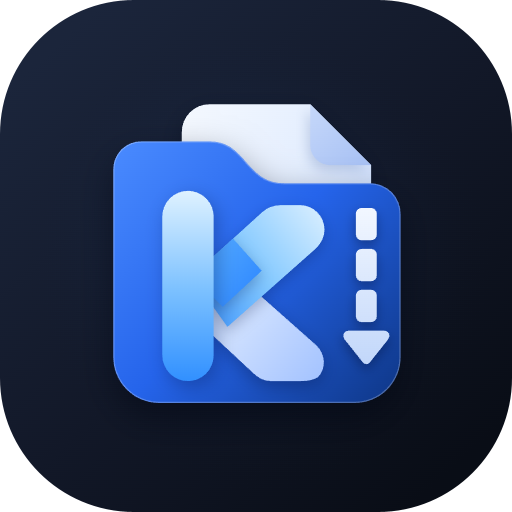
</p>

<h1 align="center">KaiHatch</h1>

<p align="center">
  <strong>An Android port of <a href="https://github.com/xevrion/hatchzip">HatchZip</a> by <a href="https://github.com/xevrion">xevrion</a>, with additional features.</strong><br />
  Extract smarter. Use less space.
</p>

<p align="center">
  <a href="https://github.com/biplov13b/KaiHatch/releases"><strong>Download APK</strong></a>
  &nbsp;·&nbsp;
  <a href="https://github.com/biplov13b/KaiHatch/issues">Report an issue</a>
</p>

<p align="center">
  
  
  <a href="LICENSE"></a>
</p>

<p align="center">
  <a href="#why-kaihatch">Why KaiHatch?</a> ·
  <a href="#features">Features</a> ·
  <a href="#screenshots">Screenshots</a> ·
  <a href="#supported-formats">Formats</a> ·
  <a href="#installation--updates">Install</a> ·
  <a href="#safety--limitations">Safety</a>
</p>

---

## Why KaiHatch?

Ordinarily, extracting a large archive means keeping **the original archive and the extracted files** on your device at the same time. When storage is almost full, that can be a problem.

KaiHatch gives you two choices:

| **Standard Extraction** | **In-Place Extraction (Hatch Mode)** |
| --- | --- |
| Keeps the original archive untouched. | Progressively consumes the source archive and reclaims its space during extraction. |
| Best when you want to preserve the original. | Best when available storage is limited and you no longer need the full original archive. |

For example, when a 1 GB archive contains 2 GB of files, Standard Mode may need roughly 2 GB of **additional** free space. Hatch Mode can reuse space released from the archive as extraction progresses. The actual peak requirement depends on the archive's contents, working space, and your storage provider—so KaiHatch shows a **Storage Planner** before you start.

<p align="center">
  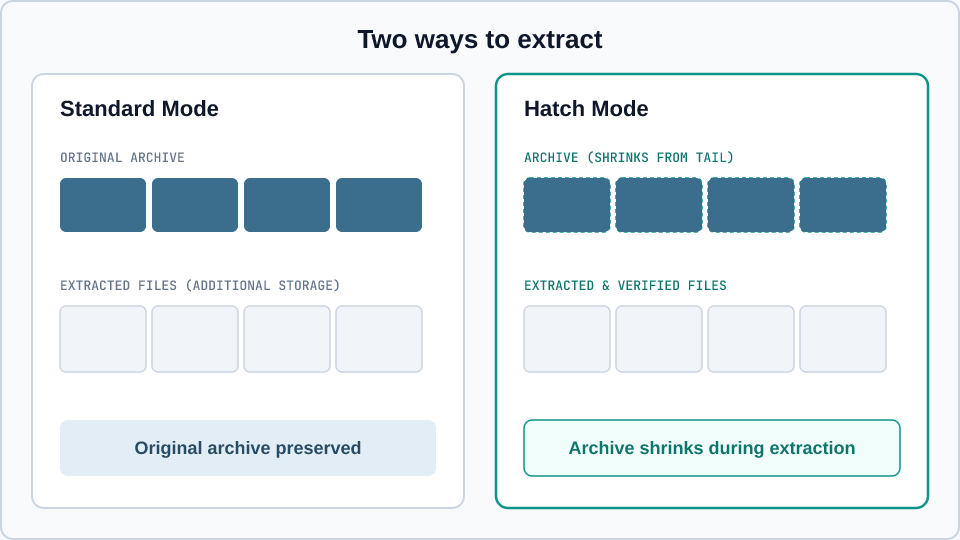
</p>

> **Important:** Hatch Mode is destructive. It changes and progressively shrinks the original archive. Choose **Standard Extraction** when keeping your original archive is essential.

## Features

### Extract with confidence

- **Storage Planner:** Compare estimated peak storage needs for Standard and Hatch modes, including temporary working space and a safety reserve.
- **Verify Before Hatch:** Run a read-only **Quick Check** for structure and headers, or **Full Verify** to stream supported payloads and check integrity/CRC32 without changing the source.
- **Live extraction controls:** Follow progress, speed, reclaimed space, verification status, and Pause / Resume / Stop actions.
- **Archive preview and browsing:** Inspect archive contents and browse your extracted files; create new archives through **Pack Studio**.

### Recover from interruptions

- **Crash-safe checkpoints:** Recovery journals and transactional checkpoints help preserve progress across supported interrupted Hatch Mode operations, including recoverable large DEFLATE tail-swaps.
- **Resume extraction:** Continue an eligible interrupted extraction after an unexpected app shutdown.
- **Restore Remaining ZIP:** Rebuild a usable ZIP/ZIP64 archive **in place** from entries that have not yet been extracted, when recovery checks permit it. A deliberate Stop also attempts safe ZIP restoration.
- **Persistent I/O Console:** Keep extraction and recovery logs across app sessions until you clear them.

Recovery and restoration are **conditional**, not guaranteed after every interruption. See [Safety & Limitations](#safety--limitations).

### Built for Android

- **Material 3 Expressive UI:** Animated, expandable Settings; themes, accent palettes, and haptic feedback.
- **32 language options:** In-app language picker, with system-language selection where supported.
- **Local storage support:** Internal storage, Downloads, and compatible SD/USB storage via Android's Storage Access Framework (SAF). Optional **All Files Access** can improve direct local-file access and recovery compatibility.
- **Built-in GitHub updates:** Check for a new stable release in **Settings → About**, receive update notifications, and download an APK verified against its SHA-256, package, version, and signing certificate. Installation uses Android's system installer and requires your confirmation.

<details>
<summary><strong>View all 32 supported language options</strong></summary>

English · Spanish · French · German · Italian · Portuguese (Brazil) · Portuguese (Portugal) · Dutch  
Russian · Ukrainian · Polish · Czech · Romanian · Hungarian · Greek · Turkish  
Swedish · Danish · Norwegian Bokmål · Finnish · Arabic · Hebrew · Persian  
Japanese · Korean · Chinese (Simplified) · Chinese (Traditional) · Indonesian · Malay · Vietnamese · Thai · Filipino

</details>

## Screenshots

**Plan, inspect, and verify**

<p align="center">
  <a href="docs/screenshots/10-unpack-setup.png">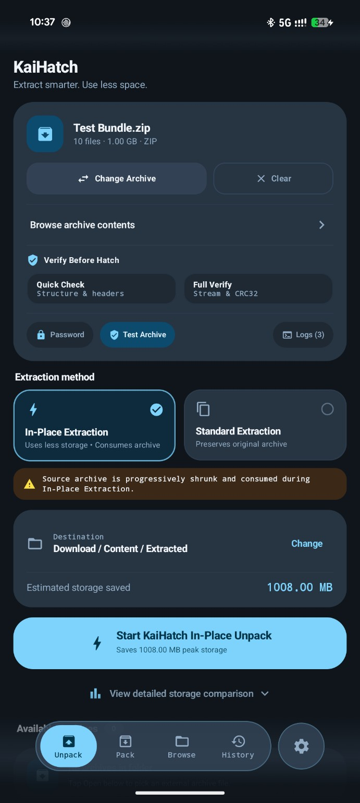</a>
  &nbsp;
  <a href="docs/screenshots/11-storage-planner.png">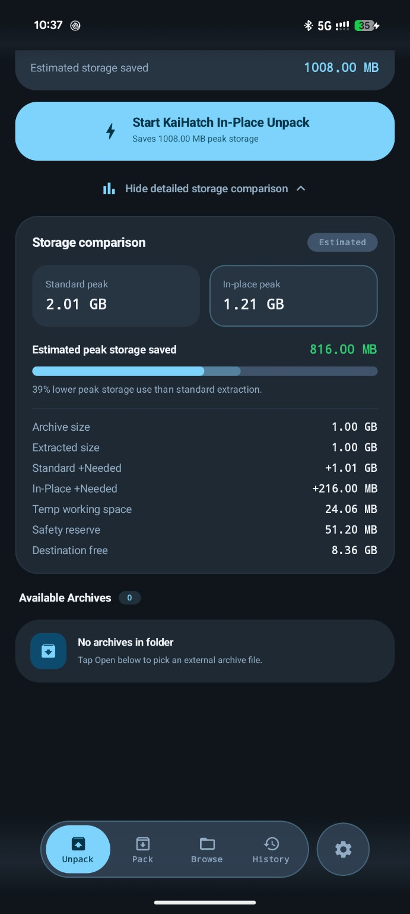</a>
  &nbsp;
  <a href="docs/screenshots/12-verify-before-hatch.png">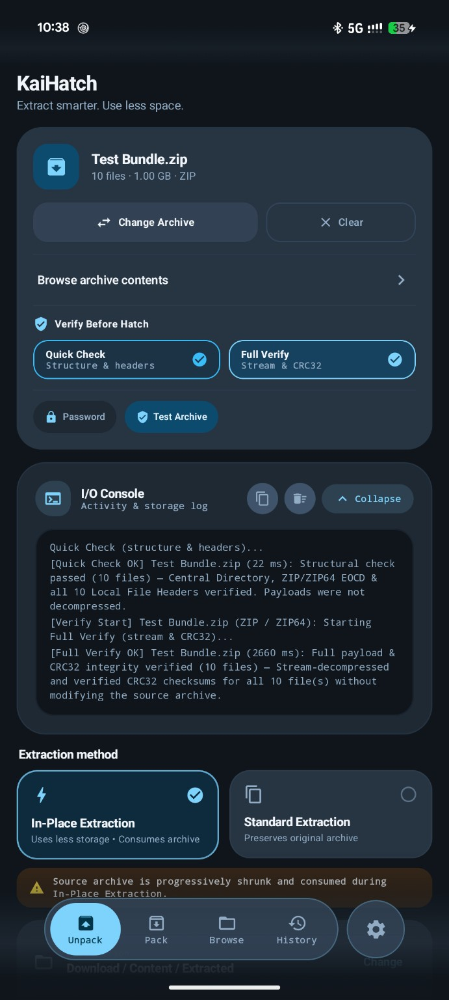</a>
</p>

**Extract, recover, and manage**

<p align="center">
  <a href="docs/screenshots/13-live-extraction.png">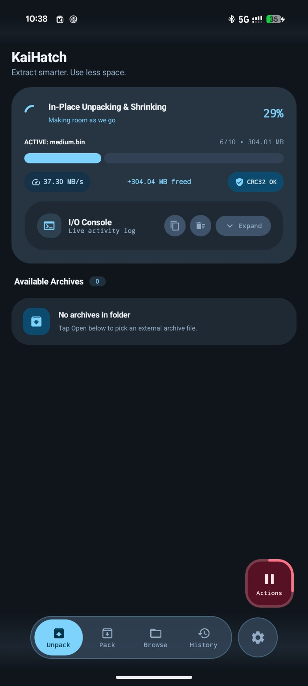</a>
  &nbsp;
  <a href="docs/screenshots/14-crash-recovery.png">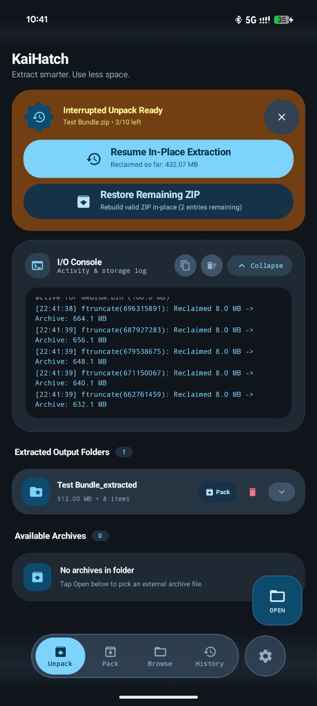</a>
  &nbsp;
  <a href="docs/screenshots/15-settings-permissions.png">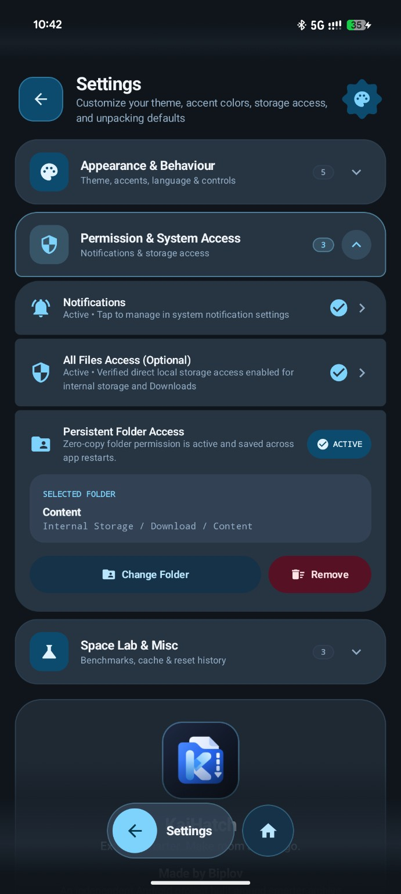</a>
</p>

**Make it yours**

<p align="center">
  <a href="docs/screenshots/16-language-picker.png">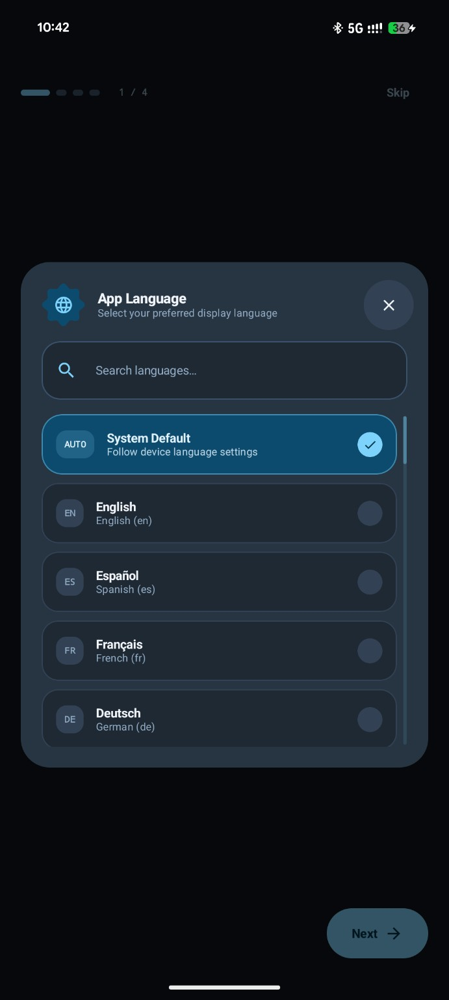</a>
</p>

<details>
<summary>First-launch onboarding and permissions</summary>

<p align="center">
  <a href="docs/screenshots/17-onboarding-permissions.png">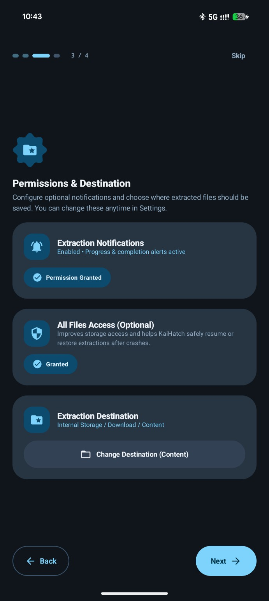</a>
</p>

</details>

## Supported formats

| Format | Standard Extraction | Hatch Mode | Notes |
| --- | :---: | :---: | --- |
| ZIP / ZIP64 / JAR / APK | ✅ | ✅ | In-place support for compatible `STORED` and `DEFLATE` entries; eligible ZIP/ZIP64 restoration. |
| TAR (uncompressed) | ✅ | ✅ | Header/checksum validation; TAR does not carry per-file CRC32 checksums. |
| 7z (non-solid) | ✅ | ✅* | Hatch Mode requires independently accessible blocks and compatible storage. |
| 7z (solid) | ✅ | ❌ | Use Standard Extraction. |
| TAR.GZ / TGZ / GZ | ✅ | ❌ | Forward-only compressed stream; Standard Extraction only. |

\* Actual Hatch Mode eligibility depends on the archive layout and the storage provider. KaiHatch does not silently switch from Hatch Mode to Standard Extraction when an in-place operation is unsupported.

**Passwords:** Password-based extraction is available for compatible archives, including supported ZipCrypto ZIP and 7z cases. Not every encryption or compression method is supported; unsupported entries are rejected rather than assumed safe for Hatch Mode.

## How Hatch Mode works

<p align="center">
  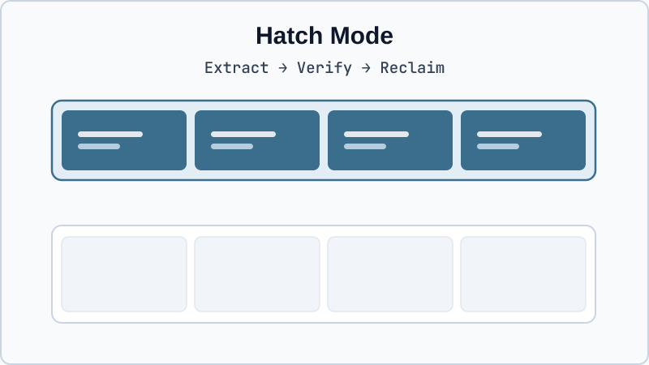
</p>

1. **Inspect and plan.** Read the archive index, check storage capabilities, and estimate working-space requirements.
2. **Work backwards.** Process eligible archive entries in reverse physical order, starting near the end of the file.
3. **Extract and verify.** Write output, check applicable checksums, and sync completed data before reclaiming the corresponding source space.
4. **Record progress.** Persist recovery checkpoints before destructive changes. Large `STORED`/`DEFLATE` entries use additional bounded/chunked extraction strategies where applicable.
5. **Reclaim space.** Progressively truncate the source archive as verified work completes.

For recoverable interruptions, KaiHatch validates its saved journal, source archive, and output before presenting **Resume** or **Restore Remaining ZIP**. ZIP restoration rebuilds the remaining archive's directory metadata **without creating a second full archive or recompressing the remaining payloads**.

## Installation & updates

1. Open [**GitHub Releases**](https://github.com/biplov13b/KaiHatch/releases) and download the latest published KaiHatch APK.
2. If supplied, verify the APK using the accompanying `.sha256` checksum file.
3. Open the APK on **Android 7.0 or newer** and approve installation in Android's installer.
4. Complete onboarding: select a language/theme, choose an extraction destination, and optionally allow notifications and **All Files Access** (where supported).

**Updating:** KaiHatch can check GitHub for newer stable releases, download a verified APK, and hand it to Android's installer. You can check manually under **Settings → About → Check for Updates**. Updating an existing installation requires the new APK to have a **higher `versionCode`** and the **same signing certificate**.

Archive extraction, verification, browsing, and compression work **offline**. Network access is used for GitHub update checks/downloads, not for processing your archives.

## Safety & limitations

- **Hatch Mode consumes the source.** Already-extracted entries have been removed from it; **Restore Remaining ZIP does not recreate the original complete archive**.
- **Recovery is eligibility-checked.** It requires intact checkpoints and accessible, consistent source/output files. Unexpected storage errors, external file changes, deleted app data, or unsupported providers may prevent recovery. If checks fail, KaiHatch refuses potentially unsafe recovery.
- **Restoration is format-limited.** In-place **Restore Remaining ZIP** applies to eligible ZIP/ZIP64 archives, not solid 7z, TAR, or arbitrary split archives.
- **Provider capabilities matter.** Hatch Mode needs seekable, writable storage with reliable positional I/O, truncation, and syncing. Some SAF/cloud-backed or read-only providers cannot support it. SAF remains available without optional All Files Access, subject to provider capabilities.
- **Pre-verification varies by format.** ZIP CRC32 checks provide payload-integrity verification when supported; TAR's header checksum cannot establish end-to-end payload integrity.
- **A pre-extraction check is not a guarantee.** Hardware failures, damaged archives, or changes in free space can still interrupt extraction. Use Standard Extraction when preserving the archive is more important than saving space.

## Build & test

**Requirements:** JDK 17+, an Android SDK compatible with the project's configured SDK, and Android Studio or Gradle.

```bash
./gradlew :app:assembleDebug
./gradlew :app:testDebugUnitTest
```

The regression suite covers recovery checkpoints, fault injection, ZIP restoration, SAF compatibility, archive integrity, storage planning, localization, and updating. Some Robolectric SDK dependencies may require network access on the first test run.

## Credits, support & license

KaiHatch brings the storage-saving extraction idea of [**HatchZip**](https://github.com/xevrion/hatchzip), created by **[xevrion](https://github.com/xevrion)**, to Android. KaiHatch's application is implemented in Kotlin and Jetpack Compose, with its own Android interface and additional features.

Built and maintained by Biplov. Feedback and bug reports are welcome in [GitHub Issues](https://github.com/biplov13b/KaiHatch/issues). You can support development on [Ko-fi](https://ko-fi.com/biplov13b).

Copyright 2026 Biplov Biswas. Licensed under the **Apache License, Version 2.0**. See [LICENSE](LICENSE), [NOTICE](NOTICE), and [THIRD_PARTY_NOTICES.md](THIRD_PARTY_NOTICES.md).
