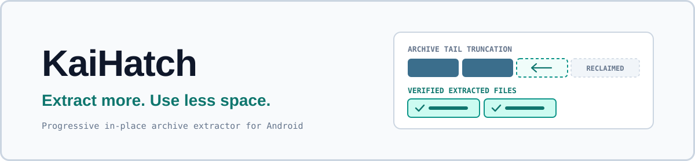
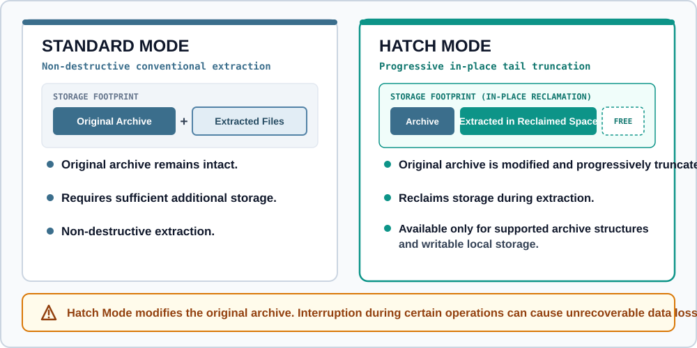

<p align="center">
  
</p>

# KaiHatch

**Extract archives on Android without needing twice the free storage.**

---

## What KaiHatch Does

Normally, unpacking a large archive on your phone requires enough free storage to hold **both** the original compressed file and all of the unpacked files at the same time. If you have a 10 GB `.zip` file and only 4 GB of free space left, standard archive apps simply fail with an "Out of space" error.

**KaiHatch** solves this for local archives on Android by offering two extraction modes:

- **Standard Mode (Safe Default):** Extracts your files normally and keeps the original archive untouched.
- **Hatch Mode (Low-Storage Mode):** Unpacks files starting from the **end** of the archive, verifies each extracted file, and **progressively shrinks the original archive in place** (`ftruncate`) to free up storage as it goes.

---

## Standard Mode vs. Hatch Mode Overview

<p align="center">
  
</p>

---

## Key Features

| | Feature | Description |
| :---: | :--- | :--- |
|  | **Progressive In-Place Extraction** | Extracts entries from the tail of the archive backward and truncates the source file after each entry is committed, reclaiming free space during extraction. |
|  | **Verify Before Truncate** | Validates extracted output against archive `CRC32` checksums and syncs data to disk (`fsync`) before removing corresponding bytes from the archive. |
|  | **Direct Local & SAF Storage Access** | Works directly on writable local Android storage—including **Downloads** and **Internal / SD Card Storage** via Android's Storage Access Framework (`"rw"` file descriptors). |
|  | **Adaptive Material 3 Interface** | Clean, distraction-free Android UI with Light, Dark, and System themes, real-time storage telemetry, and built-in Space Lab storage modeling. |

> *Device screenshots from Pixel 8 (Light & Dark themes, Hatch Mode extraction telemetry, and Space Lab) will be added here in an upcoming update.*

---

## How Hatch Mode Works

Conventional archive extractors read from the beginning of an archive and keep the entire archive file on disk until every file is unpacked.

<p align="center">
  
</p>

KaiHatch's **Hatch Mode** reduces peak storage usage through four mechanisms:

1. **Reverse Physical Offset Ordering:** Archive entries are sorted in descending order of their physical byte offset (`headerOffset` / `dataOffset`). The entry closest to the end of the archive is extracted first.
2. **Verify-Before-Truncate:** Each entry is extracted to its destination path, verified against its archive `CRC32` (for `STORED` and `DEFLATE` ZIP entries and `.7z` entries where present), and synced to disk (`fsync`) **before** the source archive is truncated.
3. **Progressive `ftruncate` Shrinking:** Once an entry's output is durably committed and verified, the source archive file descriptor (or local SAF `ParcelFileDescriptor` opened in `"rw"` mode) is truncated down to that entry's starting offset via `Os.ftruncate`, immediately returning storage blocks to the filesystem.
4. **Decompress-First Large-Entry Tail-Swap:** When a single large entry (`STORED` or `DEFLATE`) cannot fit alongside the full source archive:
   - **Reverse-Slice `STORED` Extraction:** Uncompressed `STORED` entries are copied in reverse slices from the tail of the archive and truncated slice-by-slice, with the final forward pass verifying the full `CRC32`.
   - **Decompress-First `DEFLATE` Tail-Swap:** Using Java's native `Inflater`, KaiHatch first decompresses the entry from `slot 0` through `N`, capturing the initial decompressed chunk (`chunk 0`) into a temporary tail file while streaming subsequent chunks (`1..N`) to the destination file and verifying the full `CRC32` **before** any source bytes are modified. Only after full decompression and CRC verification succeed does it truncate the tail of the source archive, copy `chunk 0` into `slot 0` of the archive, shift chunks `1..N` into place, truncate any remaining padding, and atomically rename the file.

---

## Standard Mode vs. Hatch Mode & Safety Warning

<p align="center">
  
</p>

| Behavior | Standard Mode | Hatch Mode |
| :--- | :--- | :--- |
| **Original archive file** | Preserved untouched | Progressively shrunk and consumed |
| **Peak extra free space needed** | Full uncompressed size of all files | Only a single entry or bounded working chunk at a time |
| **Best used when** | You have plenty of free space or want to keep the archive | Free storage is tight and you no longer need the archive after unpacking |
| **Effect of mid-extraction interruption** | Original archive remains completely intact | Already-truncated tail entries are removed from the archive; interrupting a final single-entry tail-swap can leave the archive unrecoverable |

> **WARNING — Destructive In-Place Operation:**
>
> **Hatch Mode modifies, truncates, and ultimately deletes the original archive file in place** in order to extract archives when free disk space is smaller than the archive itself.
>
> Hatch Mode is **not** risk-free. Because it alters the original archive file on disk, interrupting extraction during specific destructive phases (or encountering corrupted archive entries mid-stream) can leave the original archive partially consumed or unrecoverable. Always use **Standard Mode** when you have sufficient free storage or cannot afford to lose the original archive. See [Known Limitations & Safety Disclosures](#known-limitations--safety-disclosures) below for full technical details.

---

## Supported Archive Formats & Limitations

| Format | Extensions | Hatch Mode (In-Place Shrinking) | Standard Mode (Non-Destructive) | Notes & Constraints |
| :--- | :--- | :---: | :---: | :--- |
| **ZIP / ZIP64 / JAR / APK** | `.zip`, `.jar`, `.apk` | **Yes** (`STORED` & `DEFLATE`) | **Yes** | Full `CRC32` verification on all entries; reverse-offset extraction and progressive `ftruncate`. |
| **TAR (Uncompressed)** | `.tar` | **Yes** | **Yes** | Validated via POSIX `ustar` header magic and header checksum before extraction. |
| **7z (Non-Solid)** | `.7z` | **Yes** (Independent blocks) | **Yes** | Requires independent per-entry folder blocks (`folderIndex >= 0`) with monotonically aligned physical stream offsets. |
| **7z (Solid)** | `.7z` | **No** (Explicitly rejected) | **Yes** | Solid `.7z` archives share a single forward-only LZMA/LZMA2 dictionary across entries and cannot be truncated from the tail. |
| **GZIP-Compressed TAR / GZIP** | `.tar.gz`, `.tgz`, `.gz` | **No** (Standard stream only) | **Yes** | Single continuous forward-only DEFLATE stream; cannot be truncated from the tail without invalidating earlier stream state. |

> **No Silent Fallback Policy:** When **Hatch Mode** is selected, KaiHatch never silently falls back to Standard Mode. If the selected archive format (e.g., solid `.7z`) or the underlying storage provider does not support writable in-place truncation, extraction fails immediately with a clear error message explaining why Hatch Mode cannot proceed.

---

## Installation & APK Download Instructions

1. **Download the APK:**
   - **From GitHub Releases:** Download the latest `.apk` from the repository's **Releases** page (when published), or
   - **From GitHub Actions:** Open the [**Actions**](../../actions) tab, select the latest successful **Build KaiHatch APK** workflow run on `main`, and download the **`KaiHatch-Debug-APK`** artifact (unzip the artifact archive to access `app-debug.apk`).
2. **Install on Android:**
   - Open the `.apk` file on a device running **Android 7.0 (API 24) or newer** and allow installation from your browser or file manager if prompted.
3. **First-Launch Setup:**
   - On first launch, KaiHatch walks you through a brief 4-screen onboarding flow where you can choose your preferred theme (**Light**, **Dark**, or **System**) and optionally grant a default local destination folder (such as `Download`).

---

## Technical Architecture & Storage Compatibility

- **Language & UI:** 100% Kotlin and Jetpack Compose (Material 3)
- **Minimum Android Version:** Android 7.0 (API 24 / `minSdk = 24`)
- **Target / Compile SDK:** Android 16 (API 36 / `compileSdk = 36`, `targetSdk = 36`)
- **Supported Local Storage Providers (Hatch Mode):**
  - Direct local filesystem paths (`java.io.File` / `RandomAccessFile` / `FileChannel`)
  - Local files selected via Android's Storage Access Framework (SAF) system picker (`Intent.ACTION_OPEN_DOCUMENT`) backed by local block storage—such as **Downloads** (`com.android.providers.downloads.documents`) and **Internal / SD Card Storage** (`com.android.externalstorage.documents`)—that grant `"rw"` `ParcelFileDescriptor` access and support `Os.ftruncate` and positional `pwrite`.
- **Unsupported Providers for Hatch Mode:**
  - Read-only SAF providers, virtual documents (`COLUMN_FLAGS & FLAG_VIRTUAL_DOCUMENT`), pipe/socket descriptors (`FIFO`), and cloud-backed document providers that do not expose a seekable, truncatable `"rw"` file descriptor. (Cloud storage integration is outside the scope of KaiHatch.)

---

## Building & Testing

### Prerequisites
- **JDK:** Java 17 or newer
- **Android SDK:** API 36 installed (`ANDROID_HOME` / `ANDROID_SDK_ROOT` configured)

### Build Debug APK
```bash
./gradlew :app:assembleDebug
```
The compiled debug APK is generated under `app/build/outputs/apk/debug/`.

### Run Unit & Robolectric Regression Tests
KaiHatch includes a JVM and Robolectric test suite covering fault injection, crash-consistent write-ahead journal recovery, large-DEFLATE decompress-first ordering, `CRC32` integrity verification, `.7z` solid/non-solid handling, and local SAF descriptor compatibility:

```bash
./gradlew :app:testDebugUnitTest
```

> **Note on Expected Test Failure in Phase 1 Suite:**
> `KaiHatchPhase1RegressionTest.faultInjection_largeDeflateTailSwap_tornWriteAndCrash_mustRecoverValidSha256OnResume` is an intentionally retained fault-injection test documenting the unrecoverable mid-`slot 0` torn-write window described in [Known Limitations & Safety Disclosures](#known-limitations--safety-disclosures) below. It is kept active and unsuppressed so this recovery boundary remains visible; if CI is configured to run unit tests, this test may be explicitly classified as a known expected failure while remaining visible.

---

## Known Limitations & Safety Disclosures

1. **Large Single-Entry Tail-Swap Unrecoverable Window:** When extracting a single large entry whose uncompressed output exceeds available free storage, KaiHatch performs an in-place tail-swap that overwrites the beginning of the archive (`slot 0`) after the entry has been decompressed and CRC-verified. If the process is killed, the device loses power, or an I/O failure occurs **after** `slot 0` overwrite has begun and before the final `fsync` + `rename` completes, the original compressed header at `slot 0` is already overwritten and **the archive cannot be recovered**.
2. **Mid-Stream Integrity / Decompression Failure After Partial Consumption:** In multi-entry archives, each completed entry at the tail of the archive is immediately truncated off the source archive. If a later entry at an earlier byte offset fails `CRC32` verification or decompression, all previously extracted entries remain valid on disk, and KaiHatch halts before deleting the remaining prefix of the archive—but the already-truncated tail entries are no longer present inside the source archive file.
3. **External Modification While Paused/Interrupted:** If an external app modifies or truncates a paused archive so its actual descriptor size or `slot 0` header CRC (`slot0Crc`) no longer matches the write-ahead journal checkpoint, resume is blocked to prevent silent corruption.
4. **Solid `.7z` and `.tar.gz` Archives:** Progressive tail-truncation is mathematically impossible on single-dictionary solid `.7z` streams and `.tar.gz` streams without decompressing from byte `0`. Use **Standard Mode** for these formats.
5. **Encrypted Archives:** Password-protected and AES-encrypted `.zip` and `.7z` archives are detected and rejected with an explicit unsupported-encryption error.
6. **SAF Destination Directory Permissions:** Extracting via SAF requires selecting a writable local output folder via `ACTION_OPEN_DOCUMENT_TREE`.

---

## License, Inspiration & Third-Party Acknowledgments

### Inspiration & Independence Notice
KaiHatch was inspired by the progressive in-place extraction concept of [**HatchZip**](https://github.com/Fabiannez/HatchZip).

**KaiHatch is an independent Android implementation** written in Kotlin and Jetpack Compose. It shares no source code with HatchZip and is **not affiliated with, endorsed by, or an official release of the HatchZip project**.

### License
Copyright 2026 Biplov Biswas

Licensed under the **Apache License, Version 2.0**. See [`LICENSE`](LICENSE), [`NOTICE`](NOTICE), and [`THIRD_PARTY_NOTICES.md`](THIRD_PARTY_NOTICES.md) for full license terms and third-party software attributions.
